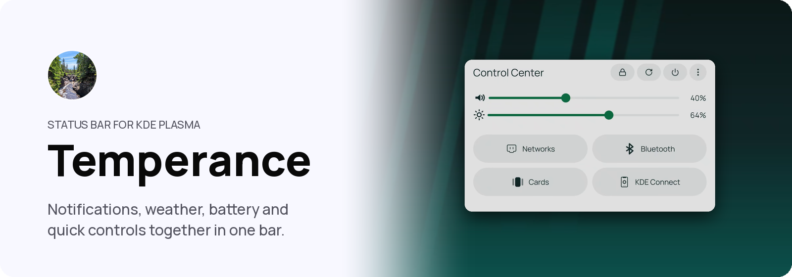
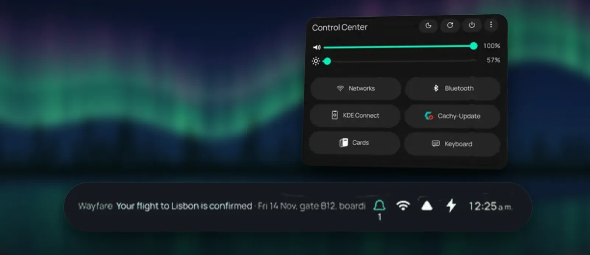

<p align="center">
  <picture>
    <source media="(prefers-color-scheme: dark)" srcset="assets/readme/banner-dark.png">
    
  </picture>
</p>

<p align="center">
  
  
  
</p>

<p align="center">
  <a href="#install">Install</a> · <a href="#controls">Controls</a> · <a href="docs/README.md">Docs</a> · <a href="#used-in-shuffle">Used in Shuffle</a>
</p>

<p align="center">Temperance is a Status Bar for KDE Plasma 6: notifications, weather, battery, common controls, the System Tray and the time, in one panel widget.</p>

<p align="center"></p>
<p align="center"><sub>Control Center, open above the bar.</sub></p>

## What you get

<table>
<tr>
<td width="33%" valign="top"><b>Notifications &amp; Events</b><br>Notifications pass through the bar, then wait in a history under today's events.</td>
<td width="33%" valign="top"><b>Control Center</b><br>Volume, brightness, connections and, where supported, performance profiles. Sleep, Restart and Shut down sit in its header.</td>
<td width="33%" valign="top"><b>System Tray</b><br>App and device icons, each shown in the bar, the popup, or nowhere.</td>
</tr>
<tr>
<td width="33%" valign="top"><b>Clock and calendar</b><br>The time, and the date if you like. Tap for a month with holidays and your calendars.</td>
<td width="33%" valign="top"><b>Weather</b><br>Current conditions and temperature, off until you turn it on.</td>
<td width="33%" valign="top"><b>Fits the panel</b><br>Fills the free space, slims for thin panels and stops pages above a bottom dock.</td>
</tr>
</table>

It replaces Plasma's System Tray presentation and brings its own clock, which you can turn off.

## Controls

| Task | Touch | Keyboard |
| --- | --- | --- |
| Notifications & Events | Tap the bell | — |
| Control Center | Tap the network icon | — |
| System Tray | Tap the tray icon | — |
| Calendar | Tap the clock | — |
| Weather | Tap the weather icon | — |

Tap an open page's icon again to close it. Every other input is in [docs/INPUT.md](docs/INPUT.md).

## Install

In a release's folder, run `./install-system.sh`, then add **Temperance** from **Add Widgets** ([details](packaging/README.md)).

<details>
<summary>Requirements, upgrading and removing</summary>

The release targets x86_64 Plasma 6.7.4, Qt 6.11.2 and KDE Frameworks 6.29 on a horizontal Wayland panel, and needs KCalendarCore. Its native plugin runs only on the Plasma and Qt it was built for; elsewhere it says it needs an update. It installs system-wide rather than as a user-local `.plasmoid`.

The package identity changed in 1.1.0: remove 1.0.0 and add Temperance as a new widget. `./uninstall-system.sh` removes it and puts Plasma's System Tray back.
</details>

## Details

<details>
<summary>Status Bar and notifications</summary>

The bar shows recent notifications, weather, battery, tray entries, and the time over the optional date, in the system font or one you choose. If enabled, volume or brightness changes show briefly. Turned-off sections give their space to the rest.

An app's notifications group together and keep the app's own actions, such as reply. Critical and selected system alerts show as larger banners, timed or kept until dismissed. The bell shows how many are waiting, or just the bell.
</details>

<details>
<summary>Calendar, Control Center and tray</summary>

The calendar is a small card in the corner. Link calendars by pasting their private iCal address from Google, iCloud or Outlook; they are read-only and refresh every ten minutes. Today's next timed event shows in the bar.

Control Center's header always shows Shut down and keeps Lock and Log out behind More. Each other control can stand, wait behind More, or hide. Controls the machine lacks are left out. Control Center and the tray work with notifications or weather off.
</details>

<details>
<summary>Settings and privacy</summary>

**Configure Temperance**, in the widget's menu, opens Shuffle Settings where installed, otherwise:

- **Tray Entries**: where each tray entry appears.
- **Appearance**: session controls, highlight color, width, notification and weather sections, the bell, temperature unit, weather app, clock and font, important alerts, popup pin, Control Center entries.
- **Calendar**: linked calendars and their colors.

With the online weather fallback on, Temperance sends the configured station coordinates or location name to Open-Meteo hourly when Plasma's Weather widget has no temperature. Turn it off to keep weather local.
</details>

## For developers

<details>
<summary>Building, checks and attribution</summary>

Read `AGENTS.md` first; `docs/README.md` indexes the docs.

Building needs C++20, CMake, Ninja, ECM, Qt 6.9 and KDE Frameworks 6.20 or newer, with development files for Plasma, PlasmaQuick, Qt Concurrent/Core/DBus/Gui/Network/Quick/Widgets, KCalendarCore, PulseAudioQt, libkscreen, and Plasma Workspace's NotificationManager and KWorkspace; the tests add LayerShellQt.

```sh
cmake -S . -B build -G Ninja -DCMAKE_BUILD_TYPE=RelWithDebInfo
cmake --build build
./verify.sh                    # the repository checks
./packaging/build-release.sh   # the release archive
```

The tray host in `src/`, `libdbusmenuqt/` and `qml/` derives from KDE Plasma Workspace 6.7.4; `tools/upstream.sh` records it file by file.
</details>

## Used in Shuffle

Temperance works on any Plasma 6 panel. [Shuffle](https://shuffleplasma.com), a touch-first desktop built on KDE Plasma, uses it as its Status Bar, alongside the open-source [Kadunce](https://github.com/carlsonjm/kadunce), [Tettegouche](https://github.com/carlsonjm/tettegouche), [Gooseberry](https://github.com/carlsonjm/gooseberry), [Shuffle Keyboard](https://github.com/carlsonjm/shuffle-keyboard) and [Split Rock](https://github.com/carlsonjm/split-rock).

## License

Licensed GPL-2.0-or-later ([LICENSE](LICENSE)); see the SPDX headers, [LICENSES](LICENSES), and [THIRD_PARTY_NOTICES.md](THIRD_PARTY_NOTICES.md) for per-file terms and attribution. The project names and marks are not covered by that licence; see [TRADEMARKS.md](TRADEMARKS.md).

<p align="center"><picture><source media="(prefers-color-scheme: dark)" srcset="assets/readme/good-input-white.png"></picture></p>
